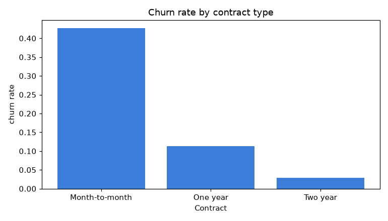
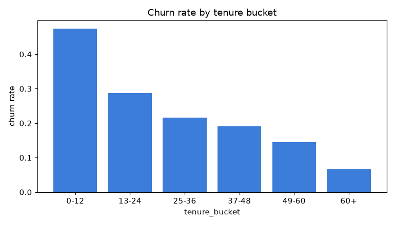
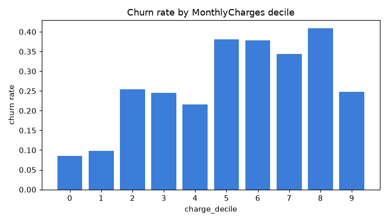
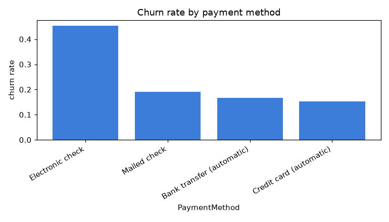
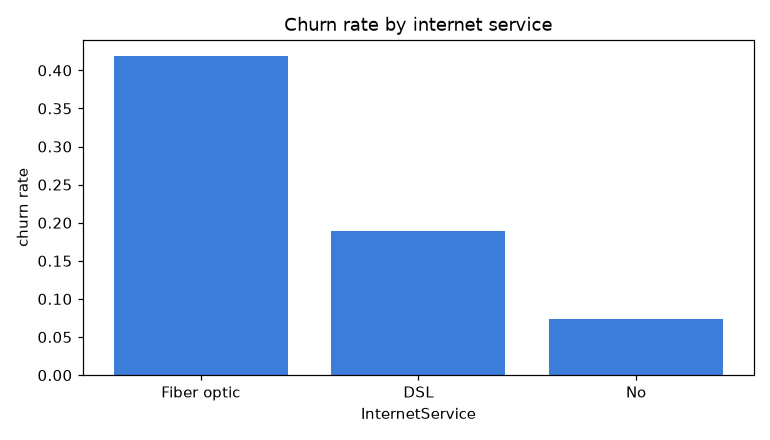
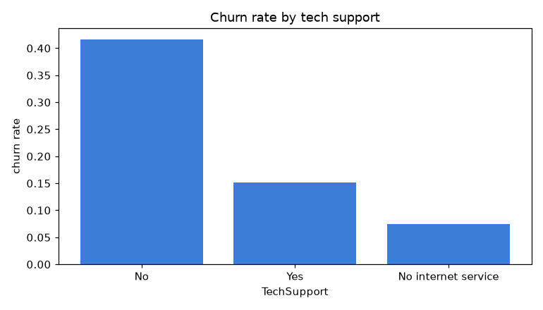

# Exploratory Data Analysis

Overall churn rate: **26.5%** (1869 of 7043).
Each section answers a specific business question.

## 1. Does contract type drive churn?

- Month-to-month churns far more than fixed-term. Highest group: **Month-to-month** at 42.7%.

## 2. Is churn front-loaded in tenure?

- Churn is concentrated in the first year (**0-12** bucket: 47.4%), then falls with tenure.

## 3. Are customers price-sensitive?

- Churn rises with monthly charges, consistent with price sensitivity.

## 4. Does payment method matter?

- **Electronic check** has the highest churn (45.3%) — the electronic-check pattern.

## 5. Fiber vs DSL

- Highest-churn internet type: **Fiber optic** (41.9%).

## 6. Do add-on services retain?

- Customers without tech support churn more, suggesting add-ons aid retention.

## 7. Collinearity trio
- `TotalCharges` ~ `tenure x MonthlyCharges` (see data quality report);
  interpret these three as one correlated bundle.